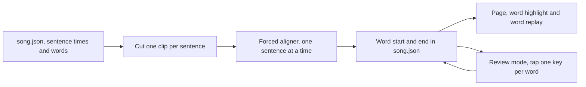

# Word alignment

Status: accepted, in progress (15 Nov 2026). First-run results are not in this file.

## Symptom

The page changes slide at each sentence. The child cannot see which word is sung at a given moment, and cannot replay one word.

## Problem

`song.json` has a start and an end for each of the 8 sentences only. The 40 words have no time. Speech-to-text does not supply them. Whisper misheard most words of this recording.

## Solution

Forced alignment of the known lyrics, then a correction by ear.

| Step | Decision | Reason |
|---|---|---|
| Unit | Syllable, then grouped into the words of `song.json` | Vietnamese writes one syllable per space |
| Scope | One sentence clip per run | An error cannot move into the next sentence |
| Aligner | MMS forced-alignment model through `torchaudio` | Covers Vietnamese, runs on a laptop CPU |
| Check | Compare word starts with sound onsets, then listen | Aligners are trained on speech, not on song |
| Correction | Review mode at `#review`: tap once per word, copy the JSON back | 40 words take a few minutes by hand |

**Options not chosen**

| Option | Why not |
|---|---|
| Whisper word timestamps | Wrong words and wrong times on this recording |
| Montreal Forced Aligner | Built for speech, heavier install. Second choice if MMS is poor |
| Vocal separation first (Demucs) | Needed only with music under the voice. Not checked for this recording |
| Manual tapping only | Works for one song. Does not scale to the next songs |

## Consequences

- `song.json` gains `start` and `end` on each word. `scripts/align_words.py` writes them.
- The page highlights the current word and can play one word.
- Held notes can move a word boundary by a few hundred milliseconds. Assumption: some words need the manual correction.
- The aligner needs PyTorch. The script runs through `uv`, so the system Python stays unchanged.
- A new song needs sentence times first. Today these come from silence detection plus a check by ear.
